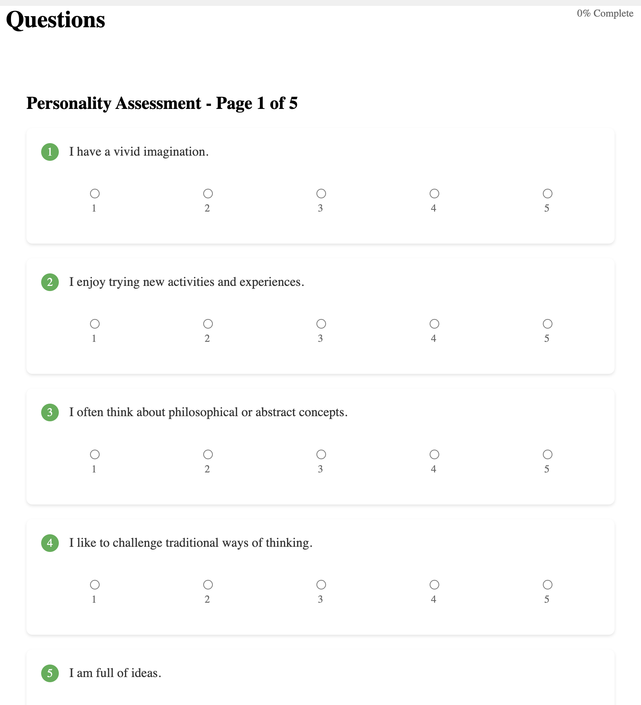
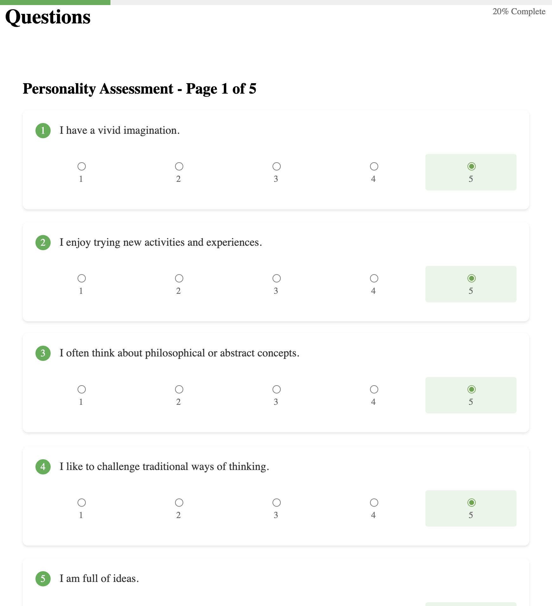
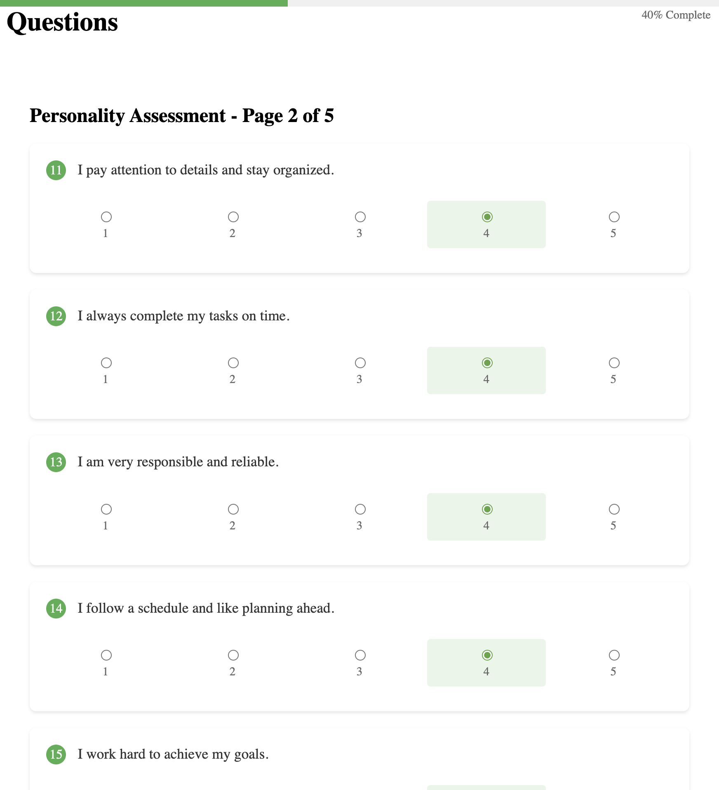
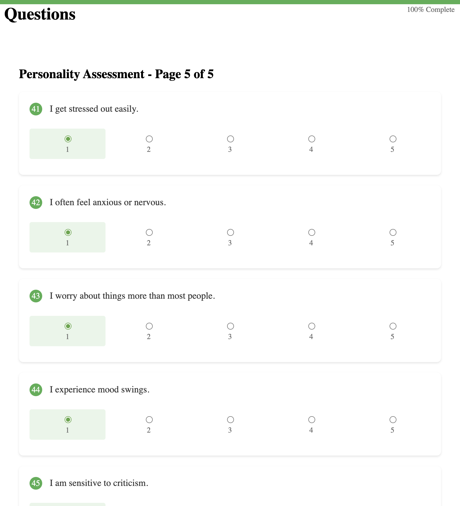
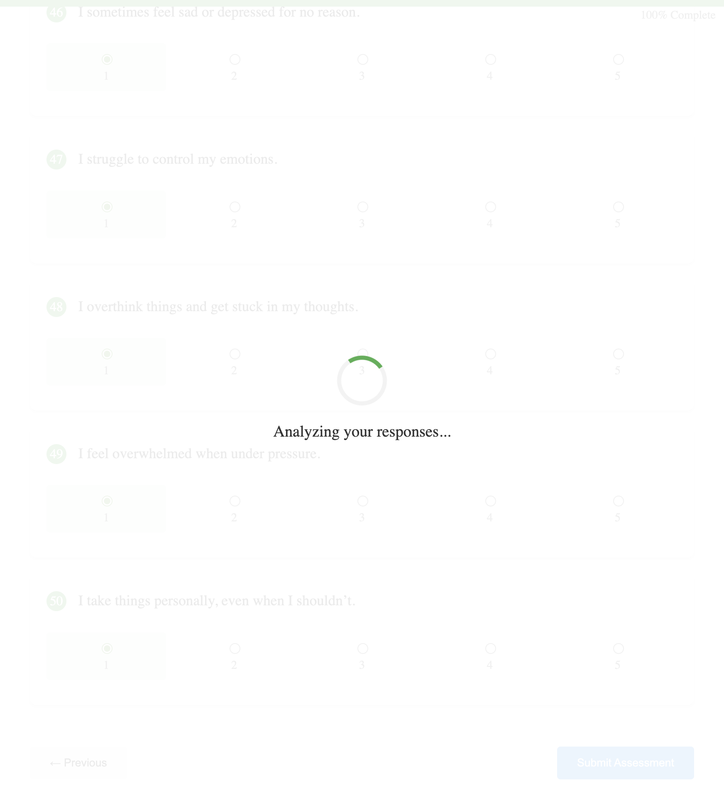
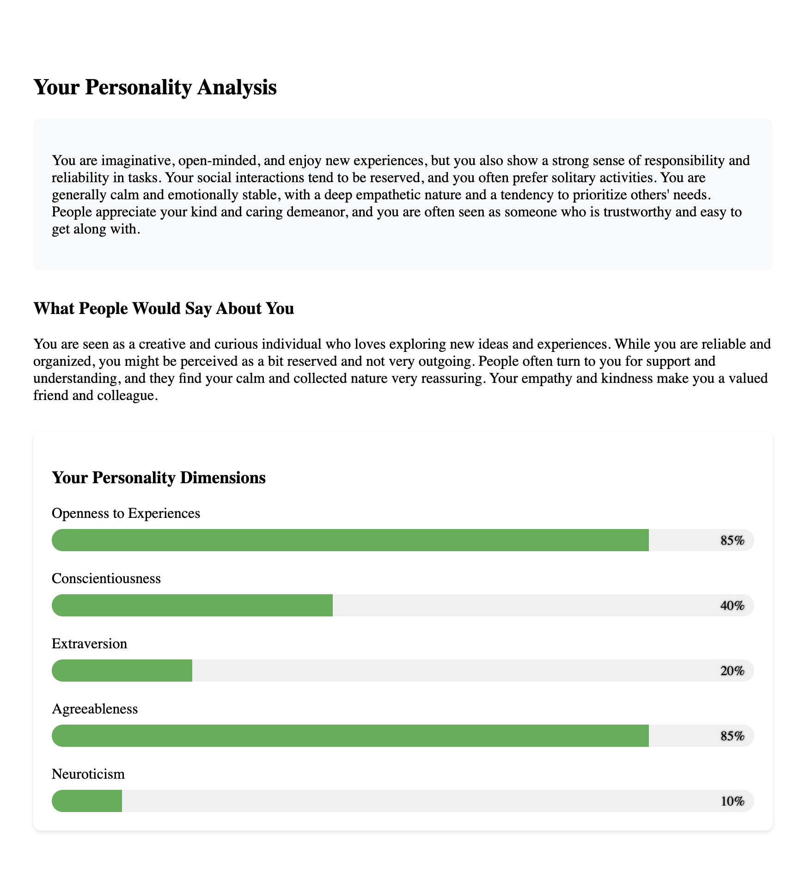

# Personality-analyser

**Fifty Big Five questions, five pages, then a local model writes the profile.**


Answer ten statements at a time, on a scale of 1 to 5. Submit sends the whole set to Spring AI, which asks the Ollama model on your machine. The page comes back with a paragraph, what people would say about you, and five bars.





```
10 questions  -->  Next
        ...
page 5        -->  Submit
                    |
                    v
            POST /api/person
                    |
                    v
         Ollama  -->  five trait bars
```

## Why this exists

A personality quiz on the web scores you on a server you do not run. This one keeps the questions in MySQL and the write-up on the model you already have in Ollama. You see the statements, the progress, and the bars in the same window.

## Quick start

Java 23, Maven, Node, MySQL, and [Ollama](https://ollama.com) on `http://localhost:11434`.

`src/main/resources/application.properties` points at `jdbc:mysql://localhost:3306/perso-traits`. The username, password, and `spring.ai.ollama.chat.options.model` are blank in the file. Fill those in. Hibernate is set to `update`, so the first boot creates the tables and, if `question` is empty, loads the 50 statements.

Compile with annotation processing turned on. Without it, Lombok never writes the getters and `mvn spring-boot:run` fails on `getContent()`.

```bash
git clone https://github.com/AbdelghaniElaoud/Personality-analyser.git && cd Personality-analyser
mvn spring-boot:run -Dmaven.compiler.proc=full
```

In another terminal:

```bash
cd src/FE/persona && npm install && npx ng serve
```

1. Open http://127.0.0.1:4200/questions. The heading is **Personality Assessment - Page 1 of 5**.
2. Score every row on the page. **Next** stays off until that page is complete. There are five pages, ten statements each.
3. On the last page, **Submit Assessment**. The overlay says **Analyzing your responses...** The result replaces the form.

## What you get

- Fifty statements, grouped as openness, conscientiousness, extraversion, agreeableness, and neuroticism. The list is seeded once, from `DataInitializer`.
- A fixed bar at the top that fills as you answer. **Previous** steps back without wiping the scores you already picked.







- A result in the second person: a summary, a "what people would say" paragraph, and a percentage for each trait. The model is asked to average the 1 to 5 answers and to answer as "you are".

One completed run, openness and agreeableness high, extraversion and neuroticism low, came back like this:



Openness 85%. Conscientiousness 40%. Extraversion 20%. Agreeableness 85%. Neuroticism 10%. Those percentages are what that model returned for those answers. They are not a fixed formula in the Java code.

- The questions API is `GET /api/question`. Submit is `POST /api/person`.
- A second prompt on the same client, `GET /api/ask/{year}`, asks the model for a World Cup winner, squad, and host. The Angular app does not call it.

## Make it yours

The statements are the list in `DataInitializer`. The prompt and the five fields are `PromptMaster.personalityAnalysis` and the `Personality` record. The pages are `questions-list.component`. Fork it, change the tone of the prompt, or point `spring.ai.ollama.chat.options.model` at another local model, and open a pull request.

If you wanted the quiz and the write-up on your own machine, [star the repo](https://github.com/AbdelghaniElaoud/Personality-analyser). [Star history](https://star-history.com/#AbdelghaniElaoud/Personality-analyser&Date).

The repository does not ship a license file yet.
